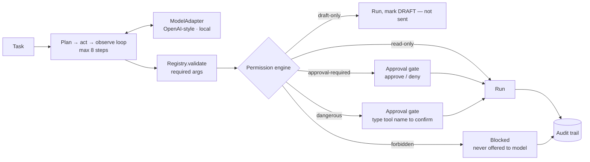

# Agentic Harness

**A model-agnostic agent runtime in TypeScript where every tool call passes through a five-level permission engine: read freely, draft safely, ask a human before anything irreversible, demand typed confirmation for destructive actions, and never offer forbidden tools to the model.**

Giving an LLM tools is easy; giving it tools you'd let it use unattended is not. This harness is the governed core of a tool-using agent: one adapter interface so any model can drive the loop, a registry that validates arguments before handlers run, a permission engine that decides what happens to each call, a pluggable human-approval gate, and an audit trail of every decision.



## What it does

- **One adapter, any model.** The loop only sees a canonical `ModelResponse` (`text` or `toolCalls`). Adapters translate OpenAI-style function calling and a local-runtime format into it; swapping models doesn't touch the loop, registry, or permissions.
- **Permissions by construction.** Each tool declares one of `read-only`, `draft-only`, `approval-required`, `dangerous`, or `forbidden`. Forbidden tools are filtered out of the specs sent to the model, so it can't even request them.
- **Validation before execution.** Missing required arguments are returned to the model as an error instead of reaching the handler.
- **Denials become feedback.** Blocked or denied calls are sent back as tool results, so the agent can revise its plan rather than crash.
- **Human approval is an interface.** `ApprovalGate.ask()` has a CLI implementation that shows the action, arguments, and reasoning; the same interface could back a Slack button or web modal.
- **Context-aware tightening.** `permissions/policy.ts` defines policies that can only make a tool *stricter* — for example, unattended `cron` runs turn approval-required and dangerous tools into forbidden ones, since nobody is there to approve.
- **Bounded runs.** The loop stops after a step ceiling (default 8).

## Example run

A scripted model asks to list files, send an email, and delete a repository. The human approves the email and fails the typed confirmation for the delete:

```text
⏸  APPROVAL NEEDED
   action:   send_email
   args:     {"to":"owner@example.com","subject":"Bug report","body":"See bug_report.txt"}
   reasoning: model requested this action
   [a]pprove / [d]eny: a

⏸  APPROVAL NEEDED
   action:   delete_repo
   args:     {"repo":"legacy"}
   reasoning: model requested this action
   type "delete_repo" to confirm: nope

final: Emailed the owner; did not delete the repo.
```

The `list_files` call is read-only and runs without a prompt. This output is from running `runAgent` with the bundled example tools and a stub adapter.

## Usage

```ts
import { Registry } from "./src/tools/registry";
import { listFiles, sendEmail, deleteRepo } from "./src/tools/examples";
import { runAgent } from "./src/loop/run";
import { cliGate } from "./src/approval/cliGate";
import { openaiAdapter } from "./src/adapters/openaiAdapter";

const reg = new Registry();
[listFiles, sendEmail, deleteRepo].forEach((t) => reg.register(t));

const answer = await runAgent(
  openaiAdapter(myChatClient),   // any client exposing chat(req) → OpenAI-shaped response
  reg,
  cliGate(askOnTerminal),        // (question: string) => Promise<string>
  "Find the bug report and email the owner.",
);
```

## Layout

| Path | Purpose |
|---|---|
| `src/types.ts` | `ToolCall`, `ModelResponse`, `Permission` |
| `src/adapters/` | `ModelAdapter` interface; OpenAI-style and local adapters |
| `src/tools/` | `Registry` (visibility, validation) and simulated example tools |
| `src/permissions/` | Decision engine and context-aware tightening policy |
| `src/loop/run.ts` | The agent loop and `ApprovalGate` interface |
| `src/approval/cliGate.ts` | Terminal approval with typed confirmation |
| `src/audit/log.ts` | In-memory audit trail |
| [TRADEOFFS.md](TRADEOFFS.md) | What the core covers and what's deliberately left out (memory, real connectors, sandboxing, evals) |

## Status and limitations

- **No `package.json`, entry point, or tests.** The modules are plain TypeScript with no runtime dependencies; run them with a TypeScript runner such as `tsx`.
- **Policies aren't applied yet.** `defaultPolicy` exists, but `decide()` uses each tool's base permission without a `RunContext`.
- **The CLI gate identifies dangerous tools by name** (`delete_repo`) rather than by the engine's `dangerous` level.
- Validation checks required keys only, not types; example tools return simulated results; the audit trail is in memory.
